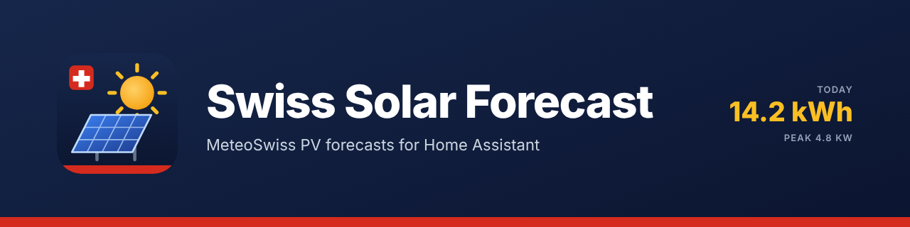

# Swiss Solar Forecast for Home Assistant

A Home Assistant custom integration that forecasts the output of your PV plant from the **MeteoSwiss local forecast**: global and diffuse radiation and air temperature, hour by hour for nine days, for every Swiss postal code — official open data, no account, no API key, no limit on the number of calls.

> **Open data only.** Everything comes from the files MeteoSwiss publishes under CC BY 4.0 on the federal geodata platform. The integration reads a few hundred kilobytes per model run with range requests instead of the 100 MB the files weigh.

## Highlights

- **Your roof from the solar cadastre**: type your address or drop the marker on the roof, and the planes of that building appear from *Sonnendach*, the Swiss solar cadastre of the Federal Office of Energy — orientation, tilt, area, suitability class and long-term yield. Tick every plane that carries modules, correct what you know better, done. No guessing of azimuths; a plane the cadastre does not know is entered by hand.
- **The MeteoSwiss forecast, on your roof**: global *and* diffuse radiation from the official model, projected on your module plane (azimuth, tilt), with the cell temperature from the forecast air temperature, your system losses and the inverter limit. No guessed cloud factors.
- **Mountains and valley sides count**: the horizon of your place is read once from the swisstopo elevation model. While the sun stands behind a ridge, the direct beam is left out and only the diffuse light counts — the late sunrise and the early sunset of a valley are in the forecast.
- **Learns from your own meter**: name the energy sensor of your plant, and the integration compares every hour what was forecast with what was counted. It learns one factor per hour of the day: the tree that shades the roof until ten, the building next door in the evening, soiling, a plant that simply does better than the textbook.
- **Energy dashboard**: the forecast appears as *solar production forecast* in the energy dashboard, like Solcast or Forecast.Solar — without an account or a daily request limit.
- **Sensors that automations can use**: energy today, tomorrow, the day after and the rest of today; power now and next hour; today's peak and when it comes. Hourly values for nine days as attributes.
- **Several roofs, one plant**: all planes in one entry, with the plant's totals and a sensor per plane; the energy dashboard gets the sum.
- **A yardstick**: with a cadastre roof, a sensor shows the long-term expectation of a day in this month and the forecast as a percentage of it — "today 60 % of a normal November day".
- **Damping by hand**: without a meter, a damping factor per plane scales the result once you have compared a few weeks with your real yield.
- **Reads sparingly**: one HEAD request every 15 minutes tells whether a new model run exists; only then are three parameter files read, about 300 KB per run, 7 MB a day. A diagnostics sensor shows the traffic.
- **Set up in a minute**: from your Home Assistant location or by typing a place or postal code; German, English, French and Italian; repairs notice when the data cannot be read; diagnostics download with your location redacted.

## Background

Since 2025 MeteoSwiss publishes its local forecast as open data: for every postal code of Switzerland, hour by hour, including the global and the diffuse radiation the models compute. That is exactly what a PV forecast needs. The usual services (Solcast, Forecast.Solar) estimate the radiation from satellite images and global models; here it comes from the national weather service's own high-resolution model, and it is free.

The forecast files are large (one file per parameter and run, all 5800 points of Switzerland). The integration reads only the rows of your point, with HTTP range requests, the way the [Swiss Meteo](https://github.com/prusuino/ha_swiss_meteo) integration does. The two integrations are independent: install either or both.

## What it provides

One device per plant, with these sensors for the plant (the planes' sum):

| Entity | Description |
|---|---|
| `sensor.swiss_solar_forecast_<id>_energy_today` | Expected energy of the local day, kWh. Attributes: the hourly power for nine days, the daily energy per day, whether the diffuse share came from the forecast, whether the terrain horizon and the self-calibration are at work. |
| `…_energy_tomorrow`, `…_energy_day_after_tomorrow` | The next two days (the day after tomorrow is disabled by default). |
| `…_energy_remaining_today` | What is still to come today, from now: the current hour pro rata, the later hours whole. |
| `…_power_now`, `…_power_next_hour` | The forecast AC power of the current and the next hour, W. |
| `…_peak_power_today`, `…_peak_time_today` | Today's highest hourly power and the middle of that hour. |
| `…_peak_power_tomorrow` | Tomorrow's peak (disabled by default). |
| `…_typical_day_energy`, `…_forecast_vs_typical` | Only with planes chosen from the cadastre: the long-term expectation of a day of this month (attributes: tomorrow, the whole month, the figure per plane) and today's forecast as a percentage of it. |
| `…_terrain_horizon` | Diagnostics, with the terrain horizon switched on: the highest angle under which the terrain is seen, in degrees. Attributes: the direction of that point, the height of the place and the whole profile (direction → angle, north-east over south to north-west). |
| `…_calibration_factor` | Diagnostics, with a yield meter: the factor learned over all hours (1 = the model fits). Attributes: the factor per hour of the day (local time), the number of hours learned, the last one, and the energy of today without the calibration. |
| `…_run`, `…_requests_today`, `…_bytes_today` | Diagnostics: the model run in use, and the requests and bytes read since midnight (disabled by default). |

A plant with several planes also gets, per plane, `…_plane<n>_energy_today`, `…_plane<n>_power_now` (enabled) and `…_plane<n>_energy_tomorrow`, `…_plane<n>_peak_power_today`, `…_plane<n>_typical_day_energy`, `…_plane<n>_forecast_vs_typical` (disabled by default). The plant's `energy_today` carries the planes' figures as an attribute as well.

The energy values refresh with every model run (hourly) and the time-dependent ones every five minutes.

### The model

For every forecast hour the integration takes the global radiation on the horizontal, the diffuse radiation and the air temperature from the MeteoSwiss local forecast and computes:

1. the sun's position in the middle of the hour,
2. the irradiance on the module plane: the direct beam — only for the share of the hour in which the sun stands above the terrain horizon — projected with the angle between sun and module normal, the diffuse share with the isotropic sky model, the ground reflection with an albedo of 0.2,
3. the cell temperature (NOCT 45 °C) and the DC power of the plane with a temperature coefficient of −0.4 %/K,
4. the AC power after your system losses, clipped at the inverter limit when you set one, times the damping factor,
5. with a yield meter, the factor learned for that hour of the day.

Should a run come without diffuse radiation, the diffuse share is estimated from the clearness index (Erbs). The attribute `diffuse_from_forecast` tells which case applies. The model itself knows the terrain, but no trees, chimneys or neighbouring roofs and no snow cover: that is what the self-calibration learns from your meter. Without a meter, use the damping factor, or set up one entry per differently shaded part.

## Energy dashboard

Open **Settings → Dashboards → Energy**, in the *Solar panels* section edit your production entity and pick **Swiss Solar Forecast** under *Solar production forecast*. The dashboard then draws the forecast next to the measured production. Several entries (roofs) can be ticked at once; the dashboard adds them up.

## Automations

The sensors are plain numbers and timestamps, so the automation editor can use them directly:

- *Charge the car when more than 20 kWh are still to come today*: numeric state condition on `…_energy_remaining_today`.
- *Start the heat pump an hour before today's peak*: time trigger with an offset on `…_peak_time_today`.
- *Warn the evening before a poor day*: numeric state trigger on `…_energy_tomorrow` below a threshold at 20:00.

## Installation

### Home Assistant Marketplace (custom repository)

1. Open **Settings → Marketplace → ⋮ → Custom repositories** (Home Assistant 2026.11 or newer; on older versions **HACS → ⋮ → Custom repositories**), add `https://github.com/prusuino/ha_swiss_solar_forecast` with the category *Integration*, then download **Swiss Solar Forecast** – or use the button:

   

2. Restart Home Assistant.

### Manual

1. Copy the `custom_components/swiss_solar_forecast` folder into your Home Assistant `config/custom_components/` directory.
2. Restart Home Assistant.

## Setup

**Settings → Devices & services → Add integration → Swiss Solar Forecast.**

1. **Place.** A name for the plant, then your Home Assistant location pre-filled on the map: move the marker onto your roof, or type a street address (every address of Switzerland is known; a building without a street address is found by the marker).
2. **Roof planes.** The planes of that building from the Sonnendach cadastre, largest first, with orientation, tilt, area, suitability class (1 low … 5 top) and the long-term yield. Tick every plane that carries modules. The pencil entry adds a plane the cadastre does not know (a garage on another building, a wrong outline, a ground-mounted plant): you then enter orientation and tilt yourself. Tick it together with the others if you need both.
3. **Figures, plane by plane.** For each ticked plane a form with a name, orientation and tilt from the cadastre (correct them if you know better), the installed peak power in kWp (the form tells how much the cadastre's area would hold), the system losses (14 % is a usual figure for wiring, inverter, soiling and mismatch), the inverter's AC limit (0 for none) and the damping factor (1 to start with). The MeteoSwiss forecast point nearest to the place is chosen automatically.

**Configure** (the entry's ⚙️) changes one plane's figures; **Reconfigure** (the entry's ⋮ menu) moves the plant or changes its planes, with the current figures pre-filled. Both keep the entities, their ids and history. A second plant at another place is a second entry.

### Terrain horizon

Switched on by default. After the setup the integration reads the terrain around the place once from the swisstopo elevation model through the federal geo API: 37 lines from north-east over south to north-west, 25 km long, a height every 50 m — five requests, about 2 MB, and never again unless the plant moves. From them it keeps the angle under which the terrain is seen in every direction.

For every forecast hour the sun is looked at every ten minutes. While it stands below the terrain in its direction, the direct beam of that part of the hour is left out; the diffuse light of the sky and the ground reflection stay. In the Mittelland this changes little (the horizon is a few degrees high, and a sun that low carries little energy); in an Alpine valley it moves the start and the end of the day by hours.

- The elevation model is the **bare terrain**: mountains, hills, valley sides. Trees and buildings are not in it — that is the job of the self-calibration.
- The MeteoSwiss radiation already contains the weather, but not the shadow of the ridge behind your house: the weather model sees the terrain in cells of a kilometre.
- The sensor `…_terrain_horizon` shows the highest angle and, as an attribute, the whole profile. Until the terrain is read (or while the geo API cannot be reached) the forecast simply runs without it; the next try follows by itself.
- To switch it off: the ⚙️ of the entry, **Configure → Σ** (the whole plant).

### Self-calibration

Open the ⚙️ of the entry, **Configure → Σ**, and choose under *Yield meter* the energy sensor that counts what the **whole plant** produces: the total or daily counter of the inverter or of a meter, in Wh, kWh or MWh. From then on:

- At every full hour the integration reads the meter and compares its increase with what the model had forecast for that hour (before any calibration).
- It keeps, per hour of the day, a running sum of counted and forecast energy in which older days fade (a memory of about two weeks), and from it a factor for that hour. The forecast of every coming day is multiplied with the factor of each hour and clipped at the inverter limit again.
- A factor needs evidence: after one day it has hardly moved, after two to three weeks of productive days an hour is trusted fully. Hours without evidence use the factor of the plant as a whole. The factors stay between 0.1 and 1.5.
- Hours with next to no forecast (night, deep overcast), hours in which the meter did not move or jumped, and gaps in the readings teach nothing.

The sensor `…_calibration_factor` shows the factor over all hours and, as attributes, the factor per hour of the day, the number of hours learned and the energy of today as the model alone would have it. What was learned is kept across restarts. It starts anew when you pick another meter or change the figures of a plane or the inverter limit, and it is deleted when you remove the meter from the options.

Good to know:

- The meter must count the plant of this entry and nothing else, with a resolution of 0.01 kWh or better. A counter that only moves in steps of 1 kWh teaches nothing useful.
- The calibration learns *everything* that keeps the yield away from the model: shading, soiling, snow that stays for weeks — and also a plant that is throttled (battery full, export limit). If your plant is regularly curtailed, the factors learn the curtailment.
- Seasons shift the shadows. The fading memory follows them with a delay of a week or two.
- With the calibration on, leave the damping factors of the planes alone: a change starts the learning anew.

### Damping by hand

Without a yield meter: compare `…_energy_today` with the daily energy of your inverter over a couple of weeks with mixed weather. If the forecast runs 10 % high, set the damping factor to 0.9; if one plane is partly shaded in the morning, a lower factor on that plane is the remedy.

## Removal

1. **Settings → Devices & services → Swiss Solar Forecast**, open the entry's menu (⋮) and choose **Delete**. Repeat for every plant. The entities, their history and the device go with the entry.
2. Remove the integration itself in the **Marketplace** (or HACS), then restart Home Assistant. With a manual installation, delete `custom_components/swiss_solar_forecast` instead.
3. If the forecast was selected in the energy dashboard, pick another forecast there or none.

## Quality scale

The integration declares **Bronze** on the [Home Assistant integration quality scale](https://developers.home-assistant.io/docs/core/integration-quality-scale/): a config flow with tests, unique ids for every entity, brand images, installation and removal instructions, a connection check before an entry is created, no duplicate entries, runtime data on the config entry, and the other Bronze rules. The tier is self-assessed, as it is for every custom integration; the per-rule status is in `custom_components/swiss_solar_forecast/quality_scale.yaml`.

## Notes

- **Update cadence.** MeteoSwiss publishes a new local forecast run every hour. The integration checks every 15 minutes with one HEAD request and reads the files only when the run has changed.
- **Horizon.** Nine days hour by hour; the sensors show today, tomorrow and the day after, the attributes everything.
- **Units.** Energy in kWh, power in W; the hourly values are the mean power of the hour, so a value of 5000 W for the hour starting 12:00 means 5 kWh between 12:00 and 13:00.
- **Mountains and high places.** The forecast points of MeteoSwiss include mountain spots; pick the one at your altitude if your plant is in the hills.
- **Known limitations.** The terrain horizon knows no trees and buildings, and the self-calibration needs a meter and a couple of weeks; no snow model, no bifacial or tracker systems; the inverter limit is a hard clip of the hourly mean, so short peaks above the limit inside an hour are not modelled.

## Troubleshooting

- **Sensors unavailable, repair notice "forecast not readable".** The MeteoSwiss files could not be read for several refreshes. Check the internet connection; the service itself is usually back within the hour. Nothing to do on your side.
- **Forecast far too high or too low.** Check azimuth (180 is south) and tilt first, then the peak power (DC, kWp, not the inverter's AC rating), then name a yield meter for the self-calibration or set the damping factor.
- **Terrain horizon sensor stays unknown.** The geo API could not be reached yet; the forecast runs without the terrain and the read is tried again by itself (after six hours, then at growing intervals).
- **Calibration factor does not move.** Look at the attributes: `samples` counts the learned hours. It needs a meter with a numeric state in Wh, kWh or MWh that rises during the hour, and an hour with a forecast worth comparing.
- **Diagnostics.** The entry's ⋮ menu → *Download diagnostics* contains the planes, the run, the traffic, the hourly figures, the terrain horizon in brief and what the calibration learned, with your location and the name of the meter redacted.

## Data source & license

Forecast data: Federal Office of Meteorology and Climatology MeteoSwiss, open government data on data.geo.admin.ch, CC BY 4.0. Roof data: Sonnendach, Swiss Federal Office of Energy (SFOE), open government data through the federal geo API (api3.geo.admin.ch), source attribution required. Terrain: the elevation model of the Federal Office of Topography swisstopo (swissALTI3D), open government data through the same API. Address search: the federal address register through the same API. This integration is not affiliated with MeteoSwiss, the SFOE or swisstopo. See `NOTICE.md`.

## Disclaimer

The forecast is a model estimate from a weather forecast. Decisions about energy use, charging or selling are yours; the author accepts no liability for differences between forecast and real yield.

## Related integrations

- [Swiss Meteo](https://github.com/prusuino/ha_swiss_meteo) — the full MeteoSwiss forecast, station values, warnings, pollen and radar.
- [Swiss Solar Reference Price](https://github.com/prusuino/ha_swiss_solar_reference_price) — the quarterly reference market price for solar power fed into the grid.
- [Swiss Electricity Price](https://github.com/prusuino/ha_swiss_electricity_price) — the ElCom tariffs of your grid operator.

## Support

Issues and ideas: [GitHub issues](https://github.com/prusuino/ha_swiss_solar_forecast/issues).

## License

MIT
